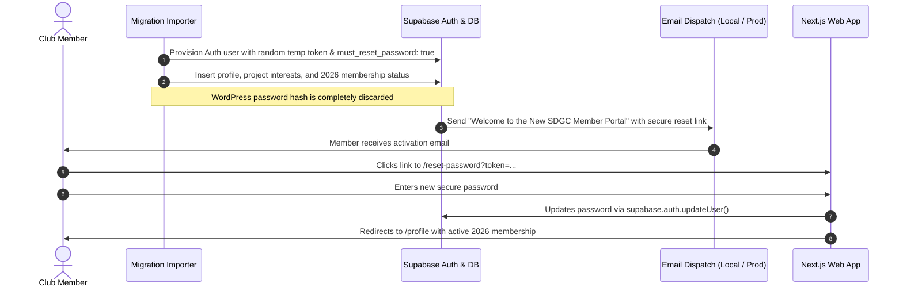

# Member Account Transition & Credential Policy

## 1. Security Decision: Rejection of WordPress Password Hashes

### Technical Rationale

Legacy WordPress stores user credentials using the portable `phpass` hashing algorithm (identifiable by `$P$` or `$H$` prefixes), often derived from MD5 iterations. Supabase Auth employs modern `bcrypt` / `argon2id` key derivation functions.

Attempting to force-inject legacy `phpass` hashes into Supabase Auth presents severe security and operational risks:

1. **Cryptographic Incompatibility:** Supabase Auth does not natively support or verify `phpass` hashes without custom unmaintained extensions.
2. **Weakened Security Baseline:** MD5-based phpass hashes are vulnerable to modern GPU rainbow table cracking. Preserving them exposes club members to credential stuffing attacks.
3. **Audit Rule Compliance:** Project guidelines explicitly stipulate:
   > _"Do not copy WordPress passwords into Supabase or claim login continuity without a supported, explicitly verified mechanism; design a reset/invite flow by default."_

---

## 2. The Invitation & Password Reset Transition Architecture

Instead of risky hash migration, SDGC implements a clean, secure **Invitation and Password Reset Transition Workflow**:

---

## 3. Member Experience & Communication Strategy

### Communication Template for Members

Prior to cutover, the club board dispatches a friendly announcement to the membership:

> **Subject:** Welcome to the New Saugatuck Douglas Garden Club Member Portal!  
> **Dear [First Name],**
>
> As part of our ongoing celebration of gardening and community beautification in Saugatuck and Douglas, we have upgraded our club website to a faster, more secure modern platform.
>
> Your profile, contact preferences, and 2026 membership standing have been safely transferred. To ensure your account is protected with the highest modern security standards, please take 30 seconds to set your personal password:
>
> **[Set My New Password - Secure Link]**
>
> After setting your password, you will be able to log in using either your username (**[username]**) or your email address to view the private member directory, review club documents, and renew annual dues.
>
> If you have questions or need assistance, simply reply to this email or reach out to our membership committee at info@saugatuckdouglasgardenclub.com.
>
> Happy Gardening,  
> **The Saugatuck Douglas Garden Club Board**

---

## 4. Self-Service Fallback

If an existing member forgets or misses their initial activation email:

1. The member visits `https://saugatuckdouglasgardenclub.com/login`.
2. Clicks **"Forgot your password?"** navigating to `/forgot-password`.
3. Enters their registered email address or username.
4. An automated recovery link is generated and sent to their inbox.
5. The member clicks the recovery link and sets their new password immediately.
